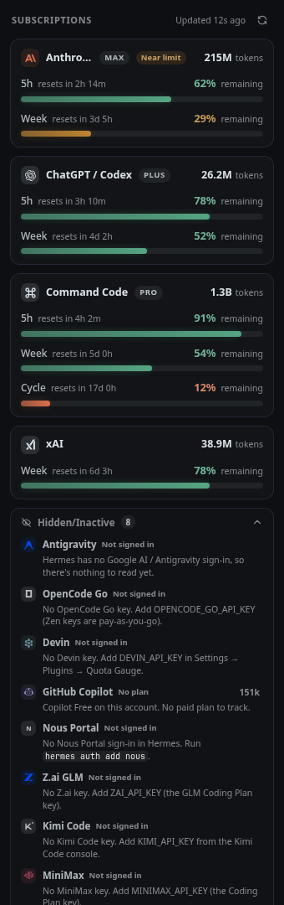

# Quota Gauge

A Hermes Desktop pane that shows how much of each AI subscription you have left, and how many
tokens you've used.

- **Draining quota bars** for every AI subscription this Hermes profile is signed in to. Each
  window starts at *100% remaining* and drains toward 0%. The colour moves green → yellow → orange →
  red, and each bar shows its reset countdown.
- **Only live subscriptions get a card.** Providers you have no sign-in, key or paid plan for fold
  into a **Hidden/Inactive** dropdown, each with a one-line reason and what would turn it on.
  Twelve providers: Anthropic, ChatGPT / Codex, Command Code, xAI, Antigravity, OpenCode Go, Devin,
  GitHub Copilot, Nous Portal, Z.ai GLM, Kimi Code and MiniMax.
- **Lifetime token totals per provider**, counted from the day tracking started: `214M`, `1.3B`.
  Hover to see the exact count (`214,386,120 tokens`) and the input / output / cache split.
- **Token charts** for *Today* (hourly), *7d* and *All time* (daily; weekly or monthly once history
  gets long), with every provider combined. Bars stack **input**, **output**, **cache read** and
  **cache write**, each shown as a coloured icon. Hovering a bar dims the rest and shows that bar's
  numbers. *Today* resets at local midnight.


<details><summary>Hidden/Inactive opened</summary>



</details>

## Install

From the plugin catalog (once listed):

```bash
hermes plugins install quota-gauge
hermes plugins enable quota-gauge
```

From Git:

```bash
hermes plugins install https://github.com/cynricantao/hermes-quota-gauge
hermes plugins enable quota-gauge
```

Then in Hermes Desktop open **Capabilities → Plugins** and switch **Quota Gauge** on. A package's
desktop half ships opt-in. The pane opens on the right; drag it anywhere.

### How it decides what's live

A card is live only when **both** are true:

1. **This profile holds a credential for it.** The plugin asks Hermes's credential pool
   (`agent.credential_pool.load_pool(<provider>).has_credentials()`), which covers `hermes auth`
   sign-ins and provider API keys alike, and checks the plugin's own declared secrets through
   `agent.secret_scope.get_secret`. It never reads `auth.json`, `.env`, vendor CLI token files or
   browser data (catalog rule 11). No credential → **Not signed in**, and no request is made.
2. **The provider reports a paid plan.** A free ChatGPT or Copilot account, an Anthropic API key
   without a Claude plan, a Command Code key on pay-as-you-go, or a key with no coding plan on Z.ai,
   Kimi or MiniMax → **No plan**.

| Provider | Signed in when | Quota comes from |
|---|---|---|
| Anthropic | Claude sign-in (`hermes auth add anthropic`) | Hermes's account-usage route |
| ChatGPT / Codex | Codex sign-in (`hermes auth add openai-codex`) | Hermes's account-usage route (read-only) |
| Command Code | `COMMANDCODE_API_KEY` | `api.commandcode.ai` with that key |
| xAI | Grok sign-in (`hermes auth add xai-oauth`) | Hermes, once it exposes Grok usage (see *Limitations*) |
| Antigravity | — | Nothing yet: Hermes has no Google AI sign-in (see *Limitations*) |
| OpenCode Go | `OPENCODE_GO_API_KEY` | Hermes's account-usage route (OpenCode Go provider) |
| Devin | `DEVIN_API_KEY` | Nothing: no quota endpoint for non-Enterprise keys (see *Limitations*) |
| GitHub Copilot | Copilot credential in Hermes or `COPILOT_GITHUB_TOKEN` | `api.github.com/copilot_internal/user` with `COPILOT_GITHUB_TOKEN` |
| Nous Portal | Nous sign-in (`hermes auth add nous`) | Hermes's Nous Portal account route |
| Z.ai GLM | `ZAI_API_KEY` (or `GLM_API_KEY` / `Z_AI_API_KEY`) | `api.z.ai` (falls back to `open.bigmodel.cn`) |
| Kimi Code | `KIMI_API_KEY` (or `KIMI_CODING_API_KEY`) | `api.kimi.com/coding/v1/usages` |
| MiniMax | `MINIMAX_API_KEY` (or `MINIMAX_CN_API_KEY`) | `api.minimax.io` (`api.minimaxi.com` for the CN key) |

Keys are the same ones the matching Hermes provider uses. Set any of them under
**Settings → Plugins → Quota Gauge**.

Token totals and charts need no credentials. They come from your own Hermes usage records.

## What it does on your machine

Disclosed per catalog rule 13:

- **Reads** this profile's `state.db` **read-only**: only the `session_model_usage` token
  counters and session timestamps, never message content.
- **Writes** one file, `<hermes home>/plugin-data/quota-gauge/ledger.db`: running token totals in
  15-minute buckets, so deleting or pruning sessions never lowers your lifetime numbers.
- **Reads credentials only through Hermes:** the credential pool (to learn *whether* a provider is
  signed in) and `get_secret` for the keys listed above. For GitHub Copilot, Hermes's pool may ask
  the `gh` CLI for a token while answering that question; that is Hermes's own lookup.
- **Network**, only for providers that are signed in, each at most once per its cache window while
  the pane is open, with that provider's own key:
  - `GET https://api.commandcode.ai/alpha/{whoami,billing/credits,billing/subscriptions}`
  - `GET https://api.z.ai/api/monitor/usage/quota/limit` (then `open.bigmodel.cn` on a 401)
  - `GET https://api.kimi.com/coding/v1/usages`
  - `GET https://api.minimax.io/v1/api/openplatform/coding_plan/remains` (or `api.minimaxi.com`)
  - `GET https://api.github.com/copilot_internal/user`

  Anthropic, Codex, OpenCode Go, Nous Portal and xAI requests are made by Hermes core, not by this
  plugin.
- **Background work:** while the Hermes backend runs, one daemon thread folds new token usage into
  the ledger once a minute, so usage lands in the right hour even when the pane is closed.
- No telemetry, no analytics, no self-updating code, and the plugin runs no shell commands.

## Refresh rate

The pane polls every **60 s**. Quota responses are cached on the backend: Command Code and xAI for
2 minutes; Codex, OpenCode Go, Z.ai, Kimi and MiniMax for 3; Anthropic, Copilot and Nous Portal for
5. Sign-in detection is re-checked every minute, so a new sign-in shows up without a restart. Anthropic's usage endpoint rate-limits aggressively, and a
`429` backs off for at least 10 minutes. The ↻ button forces a refresh, at most once per 30 s per
provider. Token charts read local data and are always current.

## Limitations

- **Anthropic with a `claude setup-token` token:** those tokens carry only the inference scope,
  so Anthropic's usage API answers 403 and the card says so. Sign in with full Claude OAuth instead.
  Hermes support for reading the `anthropic-ratelimit-unified-*` response headers is proposed
  upstream.
- **xAI:** Hermes doesn't yet expose SuperGrok/Grok subscription usage to plugins. The card shows
  a notice and your xAI token totals still count. Upstream support is proposed.
- **Antigravity:** Hermes has no Google AI / Antigravity sign-in, and reading Antigravity's own
  token files is off-limits for a listed plugin, so the card stays under *Hidden/Inactive* until
  Hermes adds one.
- **Devin:** Devin publishes ACU consumption only to Enterprise admins. With a personal or Teams key
  the card is live but explains there's no bar to draw.
- **GitHub Copilot:** Hermes doesn't hand its Copilot token to plugins. If you signed in through
  Hermes only, the card is live with a notice; set `COPILOT_GITHUB_TOKEN` for the bars.
- **OpenCode Go vs Go Plus:** OpenCode's usage API doesn't say which tier you're on, so the badge
  reads *Go* for both. The percentages are right for either.
- Token totals count usage that went **through Hermes**. Usage from other clients (Claude Code,
  the Codex CLI, the Grok app, the Command Code CLI) isn't included.
- Usage that happened while the backend wasn't running is booked at that session's latest
  activity time.

## Development

```bash
git clone https://github.com/cynricantao/hermes-quota-gauge ~/src/hermes-quota-gauge
ln -s ~/src/hermes-quota-gauge ~/.hermes/plugins/quota-gauge   # Desktop hot-reloads desktop/plugin.js
hermes plugins enable quota-gauge

# tests
uv run --no-project --with pytest --with fastapi --with httpx pytest tests -q
node --test tests/

# before every push: checks the committed tree, not the working copy
scripts/prepublish_check.sh main
```

`scripts/preview/` renders the pane outside the app with demo data for screenshots.

## License

MIT. See [LICENSE](LICENSE) and [THIRD_PARTY_NOTICES.md](THIRD_PARTY_NOTICES.md) for the
provider marks.
