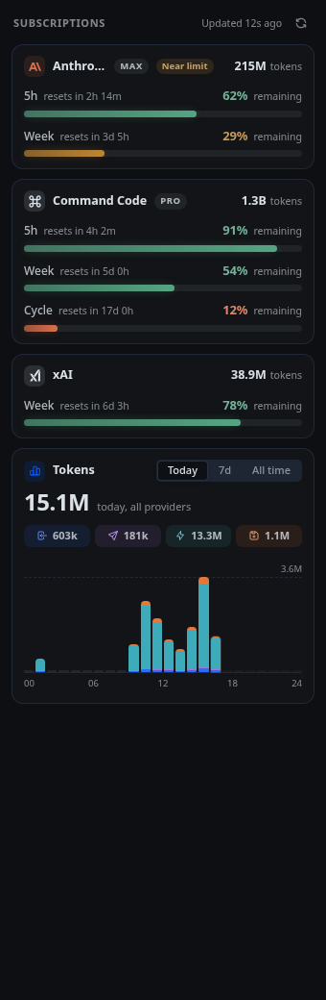

# Quota Gauge

A Hermes Desktop pane that shows how much of each AI subscription you have left, and how many
tokens you've used.

- **Draining quota bars** for Anthropic, Command Code and xAI. Each window starts at
  *100% remaining* and drains toward 0%. The colour moves green → yellow → orange → red, and each
  bar shows its reset countdown.
- **Lifetime token totals per provider**, counted from the day tracking started: `214M`, `1.3B`.
  Hover to see the exact count (`214,386,120 tokens`) and the input / output / cache split.
- **Token charts** for *Today* (hourly), *7d* and *All time* (daily; weekly or monthly once history
  gets long), with every provider combined. Bars stack **input**, **output**, **cache read** and
  **cache write**, each shown as a coloured icon. Hovering a bar dims the rest and shows that bar's
  numbers. *Today* resets at local midnight.



## Install

From the plugin catalog (once listed):

```bash
hermes plugins install quota-gauge
hermes plugins enable quota-gauge
```

From Git:

```bash
hermes plugins install https://github.com/cynricantao/hermes-quota-gauge
hermes plugins enable quota-gauge
```

Then in Hermes Desktop open **Capabilities → Plugins** and switch **Quota Gauge** on. A package's
desktop half ships opt-in. The pane opens on the right; drag it anywhere.

### Credentials

| Provider | What it needs | How it's read |
|---|---|---|
| Anthropic | A Claude **OAuth sign-in** in Hermes (`hermes auth`) | Hermes's own account-usage route. The plugin never sees the token. |
| Command Code | `COMMANDCODE_API_KEY`, the same key the Command Code provider uses | `agent.secret_scope.get_secret`; set it under **Settings → Plugins → Quota Gauge** |
| xAI | A Grok sign-in in Hermes | Hermes's account-usage route, once Hermes exposes xAI subscription usage (see *Limitations*) |

Token totals and charts need no credentials. They come from your own Hermes usage records.

## What it does on your machine

Disclosed per catalog rule 13:

- **Reads** this profile's `state.db` **read-only**: only the `session_model_usage` token
  counters and session timestamps, never message content.
- **Writes** one file, `<hermes home>/plugin-data/quota-gauge/ledger.db`: running token totals in
  15-minute buckets, so deleting or pruning sessions never lowers your lifetime numbers.
- **Network:** `GET https://api.commandcode.ai/alpha/{whoami,billing/credits,billing/subscriptions}`
  with your Command Code key, at most every 2 minutes while the pane is open. Anthropic and xAI
  requests are made by Hermes core, not by this plugin.
- **Background work:** while the Hermes backend runs, one daemon thread folds new token usage into
  the ledger once a minute, so usage lands in the right hour even when the pane is closed.
- No telemetry, no analytics, no self-updating code, no shell commands.

## Refresh rate

The pane polls every **60 s**. Quota responses are cached on the backend: Command Code and xAI for
2 minutes, Anthropic for 5 minutes. Anthropic's usage endpoint rate-limits aggressively, and a
`429` backs off for at least 10 minutes. The ↻ button forces a refresh, at most once per 30 s per
provider. Token charts read local data and are always current.

## Limitations

- **Anthropic with a `claude setup-token` token:** those tokens carry only the inference scope,
  so Anthropic's usage API answers 403 and the card says so. Sign in with full Claude OAuth instead.
  Hermes support for reading the `anthropic-ratelimit-unified-*` response headers is proposed
  upstream.
- **xAI:** Hermes doesn't yet expose SuperGrok/Grok subscription usage to plugins. The card shows
  a notice and your xAI token totals still count. Upstream support is proposed.
- Token totals count usage that went **through Hermes**. Usage from other clients (Claude Code,
  the Grok app, the Command Code CLI) isn't included.
- Usage that happened while the backend wasn't running is booked at that session's latest
  activity time.

## Development

```bash
git clone https://github.com/cynricantao/hermes-quota-gauge ~/src/hermes-quota-gauge
ln -s ~/src/hermes-quota-gauge ~/.hermes/plugins/quota-gauge   # Desktop hot-reloads desktop/plugin.js
hermes plugins enable quota-gauge

# tests
uv run --no-project --with pytest --with fastapi --with httpx pytest tests -q
node --test tests/

# before every push: checks the committed tree, not the working copy
scripts/prepublish_check.sh main
```

`scripts/preview/` renders the pane outside the app with demo data for screenshots.

## License

MIT. See [LICENSE](LICENSE) and [THIRD_PARTY_NOTICES.md](THIRD_PARTY_NOTICES.md) for the
provider marks.
